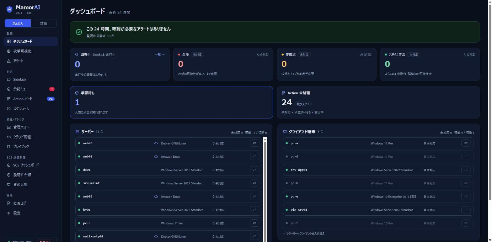
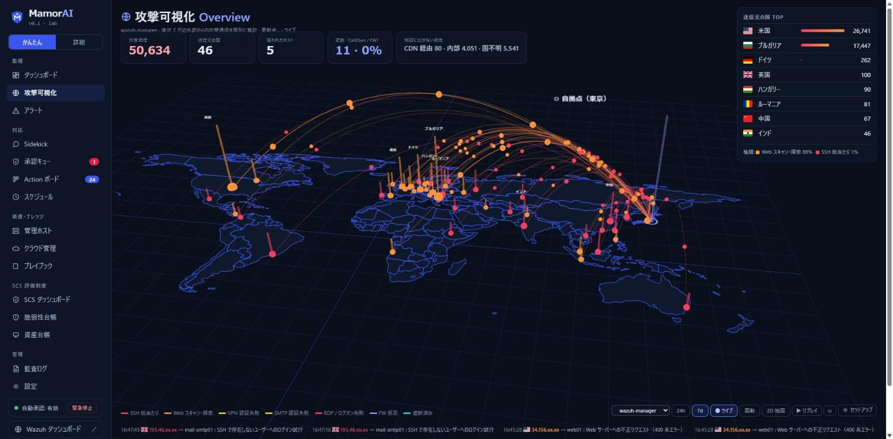
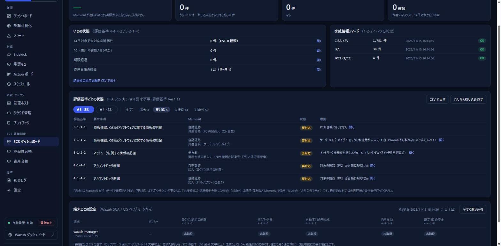

# MamorAI for Wazuh

[日本語](README.md)

> **The Wazuh edition has reached a stable milestone.**
> New feature work has moved to the next MamorAI, a separate codebase that does not use Wazuh.
> This edition stays available, and bug and security fixes are made as needed.

MamorAI is an AI-assisted operations console that runs on top of [Wazuh](https://wazuh.com/), the open-source SIEM / XDR.
The AI investigates Wazuh alerts and vulnerabilities and proposes actions; **only actions a human approves** are executed on hosts.
The UI and the AI prompts are mainly in Japanese.



| Attack map | SCS |
|---|---|
|  |  |

Host names and IP addresses in the screenshots are replaced with dummies.

## Features

| Feature | Description |
|---|---|
| Dashboard / attack map | Open (unhandled) alert counts; attack sources on a world map (Wazuh alerts, firewall deny logs, syslog) |
| Sentinel (alert-driven) | Critical/High alerts, fail2ban bans, web traffic spikes etc. trigger an AI investigation that proposes next actions |
| Sidekick (human-driven) | Ask "have a look at this" in chat; the AI investigates through the Wazuh indexer / API and SSH, proposes fixes and applies them after approval |
| Approval gate | Reads run automatically, every change needs approval (one approval per plan). Kill switch included |
| Hosts | AI host scan ("host card"); stop a service, block a port / IP, isolate a host — all approval-based (Linux over SSH, Windows through a signed active-response add-on) |
| Windows updates | Windows Update and winget upgrades, scheduled restarts (the signed-in user may postpone by 5 min / 1 h / 4 h) |
| Agent packs | Download Windows / Linux packs (Wazuh agent + Sysmon / auditd + add-on + config) from the UI; remote updates supported |
| Vulnerabilities | AI summaries of Wazuh vulnerability detection, fixed-version checks and patch requests |
| SCS (Japan's supply-chain security evaluation scheme) | Helps collect evidence for the ★3 / ★4 self-assessment (vulnerability ledger with a 14-day SLA, asset ledger, threat feeds, per-criterion status, CSV export). **MamorAI is not an evaluation body and does not guarantee any rating** |
| Self-protection | TOTP MFA, sign-in throttling, step-up re-authentication for approvals, API tokens with expiry and source-IP limits, Wazuh dashboard behind MamorAI (proxy auth) |

## Architecture

```
[Windows / Linux endpoints] --(Wazuh agent 1514/1515)--> [Wazuh manager + indexer + dashboard]
                                                                |  read-only users
                                                                v
                                                [MamorAI (Docker, :8444)] --SSH--> [managed Linux hosts]
                                                                |
                                                                +--> LLM API (OpenRouter, Anthropic, ...)
```

- Wazuh and MamorAI run on one server; `install.sh` builds both.
- MamorAI reads the Wazuh indexer (9200) and API (55000) with **read-only users**. Windows actions use a dedicated API user that can only run active responses.
- Only aggregates and the events needed are sent to the LLM; user names are pseudonymized first.

## Requirements

| Item | Requirement |
|---|---|
| OS | Ubuntu Server 26.04 LTS (clean install). The Wazuh installer warns that it is not on its recommended list; it works |
| Size | 4 vCPU, 8 GB RAM or more, 60 GB disk or more (**16 GB recommended** — with 8 GB the server swaps for a few hours when Wazuh re-downloads its whole vulnerability feed, which happens every few months) |
| Wazuh | 4.14.x (installed by `install.sh` from the official repository) |
| Network | Access to packages.wazuh.com, Docker Hub and your LLM API |
| LLM | An API key for OpenRouter, Anthropic, etc. (usage is billed to you). Optional for the install |
| Optional | Tailscale (to connect endpoints outside your site) |

Tested on:

| Environment | OS | Size | Wazuh | Endpoints |
|---|---|---|---|---|
| Author's environment (Hyper-V) | Ubuntu 26.04.1 | 4 vCPU, 8 GB, 123 GB | 4.14.7 | ~20 Windows / Linux |
| Clean-VM end-to-end test (Hyper-V) | Ubuntu 26.04.1 | 4 vCPU, 8 GB, 61 GB | 4.14.10 | — |

## Install

```bash
git clone <this repository> mamorai && cd mamorai
sudo ./install.sh                          # interactive, 10 steps (checks → Wazuh → Docker → MamorAI → finishing)
```

| Command | What it does |
|---|---|
| `sudo ./install.sh --config mamorai.conf` | Unattended, answers from a file (see `installer/install.conf.example`) |
| `sudo ./install.sh --resume` | Continue after a failure |
| `sudo ./install.sh --check` | Run the final checks only |
| `sudo ./install.sh --reinstall-mamorai` | Reinstall MamorAI only (deletes MamorAI's DB, users and .env; Wazuh is kept) |

- Console: `https://<server>:8444` (self-signed certificate at first). You choose the admin password during the install and register TOTP at the first sign-in.
- If you use the Windows add-on, the installer creates a code-signing key for your server (`/root/mamorai-signing/`). **Back it up off the server.**
- Setup guides written for your AI assistant: [docs/setup/](docs/setup/README.md) (Japanese).

## Outbound connections

| Destination | When / why |
|---|---|
| packages.wazuh.com | Install: Wazuh packages |
| Docker Hub (node:22-alpine) | Install: image build |
| Your LLM API | When the AI investigates or summarizes (aggregates and needed events, pseudonymized user names) |
| endoflife.date / nodejs.org | Fixed-version and end-of-life checks |
| www.cisa.gov / www.ipa.go.jp / www.jpcert.or.jp | Threat feeds (daily) and the SCS criteria (IPA spreadsheet) — can be turned off with the SCS setting |
| download.sysinternals.com / raw.githubusercontent.com | Windows agent packs download Sysmon and its config (SwiftOnSecurity/sysmon-config, configurable) on the endpoint |
| edgeupdates.microsoft.com / versionhistory.googleapis.com / product-details.mozilla.org / zoom.us, ... | The Windows add-on checks and downloads browser / app updates from the vendors (on the endpoint) |
| fonts.googleapis.com / fonts.gstatic.com | Web fonts of the console (from the browser that opens it) |
| Tailscale / cloud provider APIs / Discord webhook | Only if you configure them |

No telemetry is sent.

## Safety — please read

- MamorAI can **change host configuration** based on AI proposals (stopping services, blocking / isolating, package and Windows updates and restarts, adding Wazuh rules, ...).
- By default **every change requires human approval**. Review the plan (commands and rollback) before approving. The AI can be wrong.
- The kill switch stops all automatic approvals. Linux containment is reverted automatically if MamorAI loses access.
- Try it in a test environment before using it in production.
- **This software comes with no warranty** (AGPL-3.0, sections 15 and 16).

## Known limitations

- As of 2026-11-15, `npm audit` (production dependencies) reports 4 issues that need major upgrades and are not fixed: zod 3.x, react-router 6.x (no SSR is used), image-size 1.x (via pptxgenjs). Their impact is limited; they will be addressed if needed.
- Some Wazuh settings (enabling archives, agent groups, generic rules) are not automated by the installer.
- Numbers like `EDR-123` in code comments refer to the author's internal tracker.

## Author

HjK — X: [@hjkworld_ai](https://x.com/hjkworld_ai) / GitHub: [sentakuc7](https://github.com/sentakuc7)

## License

[GNU Affero General Public License v3.0](LICENSE) (AGPL-3.0-only). See [THIRD_PARTY_LICENSES.md](THIRD_PARTY_LICENSES.md) and [NOTICE](NOTICE).
Pull requests are not accepted ([CONTRIBUTING.md](CONTRIBUTING.md)). Report security issues as described in [SECURITY.md](SECURITY.md).

Wazuh is a trademark of Wazuh, Inc. This project is not affiliated with or endorsed by Wazuh, Inc.
