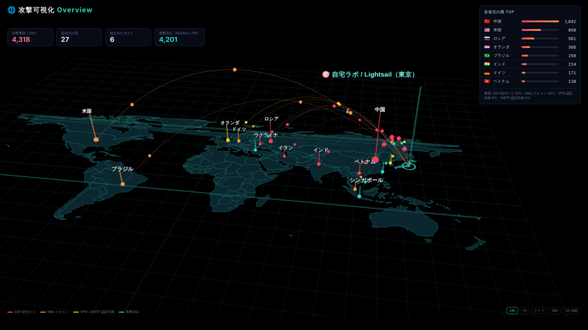
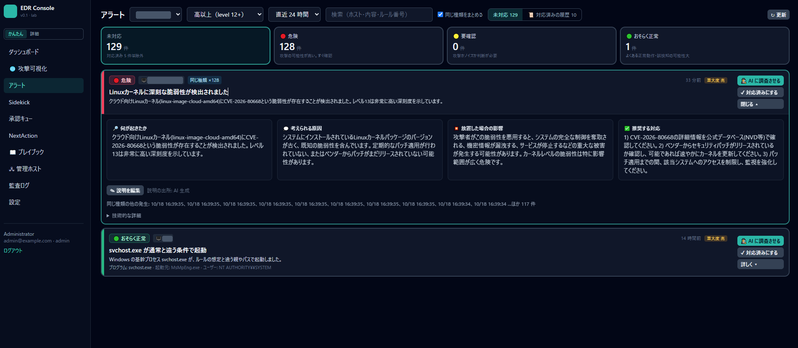
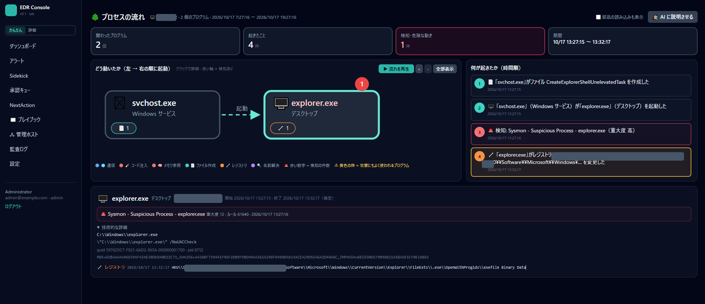

<h1 align="center">MamorAI（マモライ）</h1>

<p align="center">
  <b>AI ops console for Wazuh — see the attack, let AI investigate, keep humans in control.</b><br>
  <b>Wazuh 用 AI 運用コンソール — 攻撃を見て、AI に調べさせて、実行は人が決める。</b>
</p>

<p align="center">
  <a href="#english">English</a> · <a href="#日本語">日本語</a> · <a href="#roadmap--ロードマップ">Roadmap</a> · <a href="#faq">FAQ</a>
</p>

<p align="center">
  
  
  
  
</p>

> **⭐ Star / 👁 Watch this repo to get notified when v0.1 ships (target: late November 2026).**
> **⭐ Star / 👁 Watch しておくと v0.1 公開（2026 年 11 月下旬予定）時に通知が届きます。**

---

<p align="center">
  
</p>

---

## English

### What is MamorAI?

MamorAI is a self-hosted web console that sits on top of your existing **[Wazuh](https://wazuh.com/)** deployment and adds three things:

| | Feature | Status |
|---|---|---|
| 🌐 | **Attack Visualization** — 3D world map of inbound attacks, per-country / per-rule breakdown, hourly timeline, live updates. The thing that went viral. | v0.1 |
| 🔍 | **AI Sidekick** — ask "what is this alert?" and get an investigation with evidence pulled from the Wazuh indexer, vulnerability data and the process tree. | v0.2 |
| ✅ | **Approval Queue** — the AI can *propose* actions (block IP, restart service, patch), but nothing changes state until a human approves it. Every command, diff and rollback is shown before you click. | v0.3 |

It reads the Wazuh indexer directly, so there is nothing to install on your agents.

### Design principles

1. **Human-in-the-loop by default.** Read-only investigation runs freely; anything that writes goes through the approval queue. No autonomous blocking.
2. **Runs where your data is.** Docker Compose on your own box. Works with local LLMs (Ollama) as well as hosted APIs.
3. **Wazuh stays the source of truth.** MamorAI never replaces the Wazuh manager or dashboard — it adds a layer on top.
4. **Everything is auditable.** Every AI proposal, approval and execution is logged — and can be fed back into Wazuh.

### Quick start (v0.1 — not yet released)

```bash
git clone https://github.com/sentakuc7/mamorai.git
cd mamorai
cp .env.example .env     # set WAZUH_INDEXER_URL / USER / PASSWORD
docker compose up -d
# open http://localhost:3000
```

### Screenshots

| Alerts (AI-explained, triaged) | Process tree |
|---|---|
|  |  |

*Screenshots are from the pre-rename lab build ("EDR Console"); hostnames and IPs are masked.*

---

## 日本語

### MamorAI とは

既存の **[Wazuh](https://wazuh.com/)** 環境の上に載せるセルフホスト型の Web コンソールです。追加するのは次の 3 つ。

| | 機能 | 状態 |
|---|---|---|
| 🌐 | **攻撃可視化** — 世界地図 3D に着弾する攻撃、国別・ルール別の内訳、1 時間単位の時系列、ライブ更新。X でバズった画面です。 | v0.1 |
| 🔍 | **AI Sidekick** — 「このアラート何？」と聞くと、Wazuh indexer・脆弱性情報・プロセスツリーから根拠を集めて調査結果を返します。 | v0.2 |
| ✅ | **承認キュー** — AI は Action（IP 遮断・サービス再起動・パッチ適用）を *提案* するだけ。人が承認するまで何も変わりません。コマンド全文・差分・ロールバック手順を見てからクリックできます。 | v0.3 |

Wazuh indexer を直接読むので、エージェント側に入れるものはありません。

### 設計方針

1. **デフォルトで人が承認。** 読み取り専用の調査は自由に走り、書き込みは必ず承認キューを通ります。AI による自動遮断はしません。
2. **データのある場所で動く。** 自分のマシンで docker compose。ローカル LLM（Ollama）でも、各社 API でも動きます。
3. **Wazuh が正。** Wazuh manager / dashboard を置き換えるものではなく、その上に 1 層足すものです。
4. **全部ログに残る。** AI の提案・承認・実行はすべて記録され、Wazuh 側に戻して監視することもできます。

### クイックスタート（v0.1 — 未公開）

```bash
git clone https://github.com/sentakuc7/mamorai.git
cd mamorai
cp .env.example .env     # WAZUH_INDEXER_URL / USER / PASSWORD を設定
docker compose up -d
# http://localhost:3000 を開く
```

---

## Roadmap / ロードマップ

| Version | Target | Scope |
|---|---|---|
| **v0.1** | 2026-11 下旬 | Attack visualization overview, alert list (read-only), local auth, `docker compose up` |
| v0.2 | 2026-12 | AI Sidekick (investigation only), process tree, vulnerability context |
| v0.3 | 2027-Q1 | Approval queue, Action execution with rollback, audit log |
| later | — | Sentinel (auto-triggered investigation), autonomy levels L0–L3, cloud providers (Lightsail / EC2 / GCE / Hyper-V) |

Progress is tracked publicly in this repo's Issues once v0.1 lands.

## FAQ

**Is it open source?**
The core (visualization, Wazuh connector, console UI) will be released under **AGPL-3.0**. Some advanced automation features may ship separately later. The core will always be enough to run the attack map on your own data.

**Does the AI block attackers automatically?**
No. MamorAI proposes; a human approves. That is the whole point.

**Which LLMs?**
Anything with an OpenAI-compatible or Anthropic API, plus Ollama for fully local operation. Model choice is a config value.

**Does it send my logs anywhere?**
Only to the LLM endpoint you configure. With Ollama, nothing leaves your network.

**Wazuh version?**
Developed against Wazuh 4.x (indexer = OpenSearch).

## Contact

- X: [@h_____](https://x.com/) （← 実アカウントに置換）
- Blog (JP): note「AI職人になろうと思うHjK」

## License

Core: AGPL-3.0 (to be published with v0.1). Screenshots and videos in this README: CC BY 4.0.
