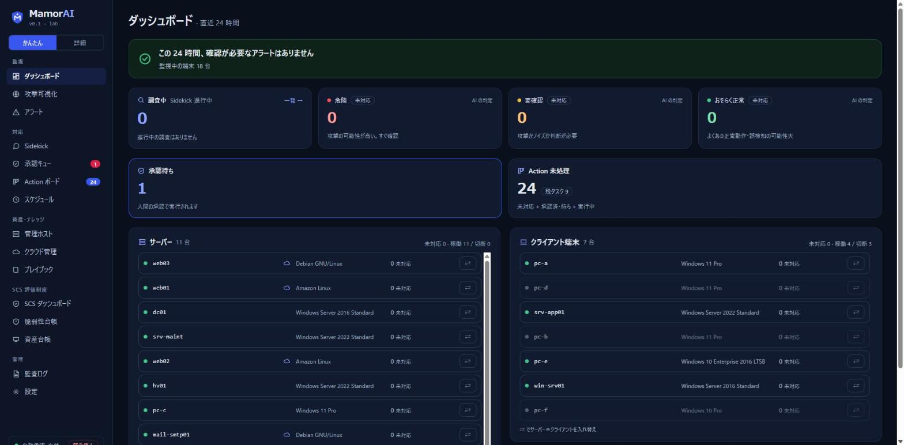
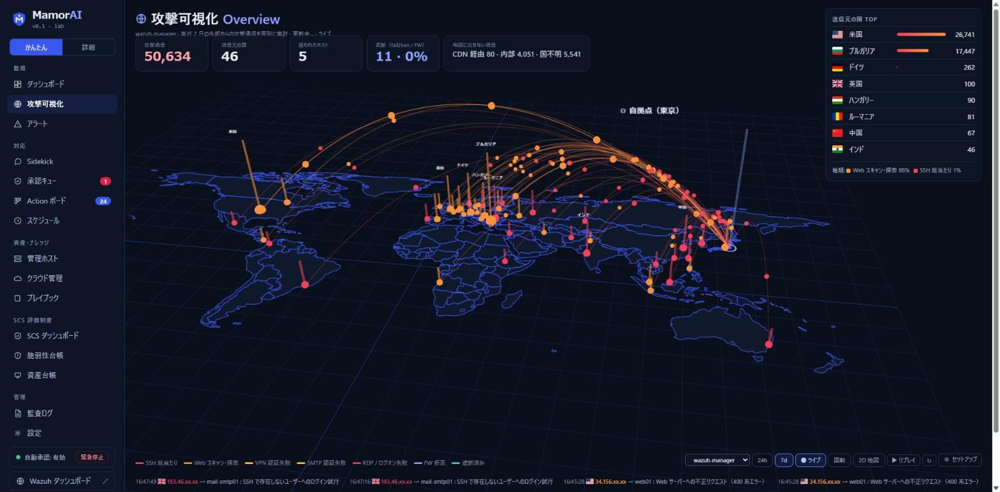
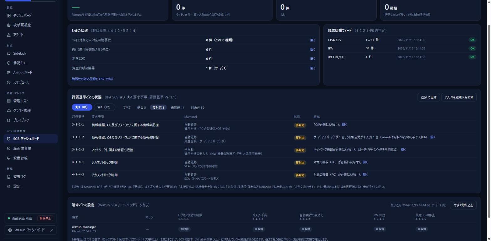

# MamorAI（Wazuh 版）

[English](README.en.md)

> **Wazuh 版はここで一区切りの安定版です。**
> 新しい機能の開発は、Wazuh を使わない次の MamorAI（別の作り）に移りました。
> この Wazuh 版は引き続き公開・利用でき、不具合やセキュリティの修正は必要に応じて行います。

MamorAI は、オープンソースの SIEM / XDR である [Wazuh](https://wazuh.com/) の上で動く、AI 付きの運用コンソールです。
Wazuh のアラートや脆弱性を AI が調べて対処案を出し、**人が承認したものだけ**をホストに実行します。



| 攻撃可視化 | SCS 評価制度 |
|---|---|
|  |  |

画面のホスト名・IP アドレスはダミーに置き換えています。

## できること

| 機能 | 内容 |
|---|---|
| ダッシュボード / 攻撃可視化 | 未対応アラートの件数、世界地図上の攻撃元（Wazuh のアラート・FW の拒否ログ・syslog から） |
| Sentinel（アラート起点） | Critical / High、fail2ban の BAN、Web の急増などをきっかけに AI が調査し、次の手を提案する |
| Sidekick（人が起点） | チャットで「これ見て」と頼むと、AI が Wazuh の indexer / API と SSH で調べ、修正案を出し、承認後に実行する |
| 承認ゲート | 読み取りは自動、変更は必ず承認。まとめて 1 回で承認できる。キルスイッチ（緊急停止）つき |
| 管理ホスト | AI によるホストのスキャン（ホストカルテ）、サービス停止・ポート遮断・IP 遮断・隔離（承認制。Linux は SSH、Windows は署名つきの自動対処アドオン） |
| Windows の更新 | Windows Update と winget の更新、再起動の予約（利用者に 5 分 / 1 時間 / 4 時間の延期を選ばせる） |
| エージェントパック | Windows / Linux 用のパック（Wazuh エージェント＋Sysmon / auditd＋アドオン＋設定）を画面からダウンロード。リモートでの更新にも対応 |
| 脆弱性 | Wazuh の脆弱性検出の結果を AI が要約し、修正版の確認（version_check）とパッチ適用の依頼まで |
| SCS 評価制度 | ★3・★4 の自己評価の根拠づくりを助ける機能（脆弱性台帳と 14 日 SLA、資産台帳、脅威情報、評価基準ごとの状態、CSV 出力）。**MamorAI は評価機関ではなく、★の取得を保証するものではありません** |
| 自己防御 | ログインの TOTP（MFA）、ログイン回数の制限、承認時の再認証、API トークンの期限と接続元の制限、Wazuh ダッシュボードを MamorAI の後ろに置く（プロキシ認証） |

## 構成

```
[Windows / Linux の端末] --(Wazuh エージェント 1514/1515)--> [Wazuh manager + indexer + dashboard]
                                                                    |  読み取り専用ユーザー
                                                                    v
                                                    [MamorAI（Docker、:8444）] --SSH--> [Linux の管理ホスト]
                                                                    |
                                                                    +--> AI（OpenRouter / Anthropic などの API）
```

- Wazuh と MamorAI を 1 台のサーバーに入れる構成です（install.sh がまとめて構築します）
- MamorAI は Wazuh の indexer（9200）と API（55000）を **読み取り専用のユーザー**で読みます。Windows への対処だけは、自動対処の実行しかできない専用の API ユーザーを使います
- AI には集計値と必要なイベントだけを送ります。ユーザー名は仮名にしてから送ります

## 必要なもの

| 項目 | 内容 |
|---|---|
| OS | Ubuntu Server 26.04 LTS（まっさらな状態）。Wazuh のインストーラーは「推奨 OS の一覧にない」と警告を出しますが、動作は確認しています |
| 性能 | 4 vCPU・メモリ 8GB 以上・ディスク 60GB 以上（**16GB 推奨**。8GB だと、Wazuh が脆弱性フィードを丸ごと取り直すとき（数か月に一度程度）にスワップして数時間重くなります） |
| Wazuh | 4.14.x（install.sh が公式の配布元から入れます） |
| ネットワーク | packages.wazuh.com、Docker Hub、使う AI の API に届くこと |
| AI | OpenRouter か Anthropic などの API キー（利用料は利用者の負担）。なしでもインストールはできます |
| 任意 | Tailscale（拠点の外の端末をつなぐ場合） |

動作を確認した構成:

| 環境 | OS | 性能 | Wazuh | 端末 |
|---|---|---|---|---|
| 作者の運用環境（Hyper-V） | Ubuntu 26.04.1 | 4 vCPU・8GB・123GB | 4.14.7 | Windows / Linux 約 20 台 |
| まっさらな VM での通しテスト（Hyper-V） | Ubuntu 26.04.1 | 4 vCPU・8GB・61GB | 4.14.10 | — |

## インストール

```bash
git clone <このリポジトリ> mamorai && cd mamorai
sudo ./install.sh                         # 対話式。全 10 段階（事前チェック → Wazuh → Docker → MamorAI → 仕上げ）
```

| コマンド | 内容 |
|---|---|
| `sudo ./install.sh --config mamorai.conf` | 回答をファイルから読む無人実行（`installer/install.conf.example` を参照） |
| `sudo ./install.sh --resume` | 失敗したところから続きを実行する |
| `sudo ./install.sh --check` | 最後の確認だけを行う |
| `sudo ./install.sh --reinstall-mamorai` | MamorAI だけを入れ直す（MamorAI の DB・ユーザー・.env を消す。Wazuh はそのまま） |

- 管理画面: `https://<サーバー>:8444`（初回は自己署名の証明書です）。管理者のパスワードはインストール中に決めます。初回ログインで TOTP を登録します
- Windows の自動対処アドオンを使う場合、インストール時にこのサーバー専用のコード署名鍵（`/root/mamorai-signing/`）を作ります。**この鍵はサーバーの外にもバックアップしてください**
- AI に読ませるセットアップ手順書（Claude や ChatGPT に読ませて進めるためのもの）: [docs/setup/](docs/setup/README.md)
- 端末への配布: [docs/agent-pack.md](docs/agent-pack.md)、ホストへの対処: [docs/host-actions.md](docs/host-actions.md)

## 外部への通信

| 通信先 | いつ・何のため | 止める方法 |
|---|---|---|
| packages.wazuh.com | インストール時に Wazuh を取得 | — |
| Docker Hub（node:22-alpine） | インストール時のビルド | — |
| 使う AI の API（openrouter.ai / api.anthropic.com など） | AI に調査・要約を頼むとき（集計値・必要なイベント。ユーザー名は仮名化） | AI を設定しない（AI の機能は使えなくなる） |
| endoflife.date / nodejs.org | 修正版・サポート期限の確認（version_check） | — |
| www.cisa.gov / www.ipa.go.jp / www.jpcert.or.jp | 脅威情報（CISA KEV・IPA・JPCERT/CC）の取り込み（1 日 1 回）、SCS の評価基準（IPA の Excel）の取り込み | 設定で SCS 機能をオフにする |
| download.sysinternals.com / raw.githubusercontent.com | Windows のエージェントパックが Sysmon とその設定（SwiftOnSecurity/sysmon-config。取得先は設定で変更可）を取得（端末側） | — |
| edgeupdates.microsoft.com / versionhistory.googleapis.com / product-details.mozilla.org / zoom.us など | Windows の自動対処アドオンが、ブラウザなどの最新版を確認・取得するとき（端末側。「ベンダー公式」の更新） | アプリの更新を使わない |
| fonts.googleapis.com / fonts.gstatic.com | 管理画面のフォント（管理画面を開いたブラウザから） | — |
| login.tailscale.com など | Tailscale を使う場合のみ | Tailscale を使わない |
| compute.googleapis.com など | クラウド管理に IaaS を登録した場合のみ | 登録しない |
| Discord の Webhook | `DISCORD_WEBHOOK_URL` を設定した場合のみ（通知） | 設定しない |

利用状況の送信（テレメトリ）はしません。

## 安全について（必ずお読みください）

- MamorAI は、AI の提案をもとに **ホストの設定を変更する機能**（サービス停止、通信の遮断・隔離、パッケージの更新、Windows の更新と再起動、Wazuh のルールの追加など）を持っています
- 変更は既定で **すべて人の承認が必要**です。承認する前に、計画（実行するコマンド・戻し方）を必ず確認してください。AI の判断は間違うことがあります
- 緊急停止（サイドバー）で、自動の承認をすべて止められます。Linux の遮断は、MamorAI が接続を失うと自動で元に戻ります
- 本番環境で使う前に、検証用の環境で動きを確かめてください
- **このソフトウェアは無保証です**（AGPL-3.0 の第 15 条・第 16 条）。利用によって生じた損害について、作者は責任を負いません

## 既知の制限・問題

- 2026-11-15 時点の `npm audit`（本番の依存）で、次の 4 件がメジャー版の更新を伴うため未対応です（影響が限られるため。必要になれば対応します）
  - zod 3.x（大きな配列の検証でメモリを使い切る問題。リクエストの大きさは 8MB に制限しています）
  - react-router 6.x（Link の開きっぱなしのリダイレクト、SSR の問題。MamorAI は SSR を使っていません）
  - image-size 1.x（pptxgenjs 経由。特殊な画像形式の解析で止まる問題。AI が作る PowerPoint に画像を入れるときだけ使います）
- Wazuh の設定のうち、archives の有効化・端末グループ・汎用ルールなど一部は、インストーラーに入っていません（手で設定するか、AI に頼んでください）
- 画面と AI の指示文は日本語が中心です
- コードのコメントにある `EDR-123` のような番号は、作者の作業管理の番号です（外からは見られません）

## 作者

HjK — X: [@hjkworld_ai](https://x.com/hjkworld_ai) / GitHub: [sentakuc7](https://github.com/sentakuc7)

## ライセンス

[GNU Affero General Public License v3.0](LICENSE)（AGPL-3.0-only）。第三者のソフトウェアは [THIRD_PARTY_LICENSES.md](THIRD_PARTY_LICENSES.md)、商標については [NOTICE](NOTICE) を参照してください。

Pull Request は受け付けていません（[CONTRIBUTING.md](CONTRIBUTING.md)）。セキュリティ上の問題は [SECURITY.md](SECURITY.md) の方法で連絡してください。

Wazuh は Wazuh, Inc. の商標です。このプロジェクトは Wazuh, Inc. とは関係がありません。
