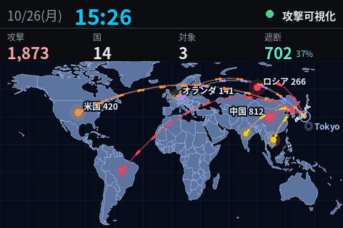
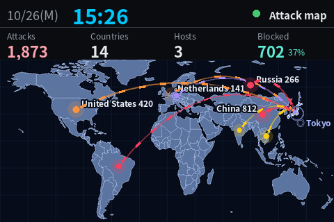

# MamorAI LCD — attack map on a 3.5" USB sub-monitor



MamorAI の **攻撃可視化（Overview）** を、数千円の 3.5 インチ USB サブモニターに常時表示するツールです。
Shows the MamorAI **attack map** on a cheap 3.5" USB sub-monitor, animation included.

- 時計・接続状態 / clock and connection status
- KPI: 攻撃通信・送信元の国・狙われたホスト・遮断（率） / attacks, source countries, targeted hosts, blocked (rate)
- 世界地図 + 送信元の国から自拠点へ流れるアーク（MamorAI の 2D 攻撃可視化を LCD 向けに移植） / world map with animated arcs (port of the console's 2D attack map)

The data is the same as the console's Overview (`GET /api/wazuh/{id}/attack-map`). The tool is **read-only**: it uses a viewer-role API token and never changes anything in MamorAI or Wazuh.

---

## 日本語

### 必要なもの

| もの | 備考 |
|---|---|
| 3.5 インチ USB サブモニター（Turing Smart Screen 3.5" **Rev A** 互換） | 動作確認した製品: [AliExpress](https://s.click.aliexpress.com/e/_c4pk3JSr)（※アフィリエイトリンクです）。Windows では「USB シリアル デバイス」、USB ID `1A86:5722` として認識されるもの |
| [turing-smart-screen-python](https://github.com/mathoudebine/turing-smart-screen-python) | LCD との通信ドライバとして使います（GPL-3.0） |
| Python 3.10 以降 | Windows 11 で確認。Linux / macOS でも動く想定 |
| MamorAI コンソールと API トークン | 閲覧（viewer）ロールで十分です |

純正のモニタリングアプリが LCD を使っている場合は、先に終了してください（COM ポートを奪い合います）。

### セットアップ（Windows）

```powershell
# 1. LCD ドライバを取得して venv を作る
git clone https://github.com/mathoudebine/turing-smart-screen-python C:\tools\turing-smart-screen-python
cd C:\tools\turing-smart-screen-python
python -m venv .venv
.\.venv\Scripts\python.exe -m pip install -r requirements.txt

# 2. このフォルダ（tools/lcd）の中身を clone したフォルダ直下にコピー
#    mamorai_lcd.py / config.example.json / register_task.ps1

# 3. まず架空データで LCD に表示できるか確認（Ctrl+C で終了）
.\.venv\Scripts\python.exe mamorai_lcd.py --list-ports    # 「<- LCD」が付いたポートがあれば OK
.\.venv\Scripts\python.exe mamorai_lcd.py --demo
```

### MamorAI と接続する

1. MamorAI の **設定 → ユーザー** で LCD 用ユーザーを **viewer** ロールで作成（「初回ログイン時にPW変更」は *不要（サービスアカウント用）*）
2. そのユーザーの **API トークン** を発行。許可 IP はこの PC の IP、期限は任意（最大 365 日）
3. 設定画面の「API アクセス（トークン認証）」が **有効** であることを確認
4. トークンを環境変数に、URL を `config.json` に設定

```powershell
setx MAMORAI_TOKEN "edrc_..."          # 新しい PowerShell から有効になる
copy config.example.json config.json   # mamorai_url を自分のコンソールに書き換える

# 新しい PowerShell で
.\.venv\Scripts\python.exe mamorai_lcd.py --preview out.png   # LCD を使わずに実データで描画
start out.png
```

### 常駐させる（ログオン時に自動起動）

```powershell
.\register_task.ps1 -RepoDir "C:\tools\turing-smart-screen-python" -PythonW "C:\tools\turing-smart-screen-python\.venv\Scripts\pythonw.exe"
Start-ScheduledTask -TaskName MamorAI_LCD
```

タスクスケジューラへの登録が権限で拒否された場合は、スタートアップフォルダへのショートカットに自動で切り替わります。`-Remove` で登録を削除できます。ログは `mamorai_lcd.log` に出ます。

### 設定（config.json）

| キー | 既定値 | 説明 |
|---|---|---|
| `mamorai_url` | `""` | コンソールの URL（例 `https://mamorai.example:8444`）。環境変数 `MAMORAI_URL` でも可 |
| `wazuh_id` | `null` | 表示する Wazuh 接続。`null` は先頭（ダッシュボードの既定と同じ） |
| `window` | `now-24h` | 集計期間: `now-24h` / `now-7d` / `now-30d` |
| `verify_tls` / `ca_file` | `false` / `""` | コンソールの証明書検証。自己署名なら `ca_file` に証明書を指定するのがおすすめ |
| `refresh_seconds` | `60` | データ取得の間隔 |
| `com_port` | `auto` | `auto` は USB ID `1A86:5722` を自動検出。固定するなら `COM3` など |
| `brightness` | `40` | LCD の輝度 0〜100 |
| `reverse` | `false` | 上下が逆さまなら `true` |
| `fps` | `8` | アニメーションの目標フレーム数。Rev A の転送速度で実際はこれ以下 |
| `labels` | `4` | 地図に国名ラベルを出す上位国数 |
| `turing_lib` | `""` | turing-smart-screen-python の場所（このファイルと同じフォルダ以外に置く場合） |
| `font` / `font_bold` | `""` | 日本語フォント。空なら Meiryo / Noto Sans CJK を自動で探す |
| `lang` | `ja` | 表示言語 `ja` / `en` |

### しくみ

- 画面は Pillow で描画し、turing-smart-screen-python の `DisplayPILImage()` で送ります
- 地図・アークの下地・国の点・ラベルはデータが変わった時だけ作り直し、毎フレームは流れる破線と拠点の脈動だけを重ねます
- 地図部分は 48×26px のタイル単位で前フレームと比較し、変わったタイルだけを転送します（Rev A は全画面転送が重いため）
- データ取得は別スレッドで行うので、コンソールが応答しなくてもアニメーションは止まりません。取得に失敗すると前回の値をグレーで残し「取得失敗」と表示します
- 世界地図（`countries-110m.json`, [world-atlas](https://github.com/topojson/world-atlas)）は初回にコンソールから取得してローカルに保存します

### トラブルシューティング

| 症状 | 対処 |
|---|---|
| `could not open port` | 純正アプリや turing-smart-screen-python の `main.py` が COM ポートを使っている。終了してから再実行 |
| 画面が白いまま / 前の画像で止まる | Rev A は初期化時に USB が一度切れる。USB を挿し直して再実行（初期化は自動で 3 回まで再試行） |
| 上下が逆 | `config.json` の `reverse` を `true` |
| 「取得失敗」で `HTTP Error 401` | トークンの許可 IP とこの PC の IP が違う、またはトークンの貼り間違い |
| `403 api access disabled` | コンソールの「API アクセス（トークン認証）」が停止中 |
| `setx` したのに未設定扱い | `setx` は新しく開いたウィンドウにだけ反映される。PowerShell を開き直す |
| `register_task.ps1` でパラメーターが見つからない | Windows PowerShell 5.1 は BOM なし UTF-8 を誤読する。リポジトリのファイル（BOM 付き）をそのまま使う |
| 日本語が □ になる | `config.json` の `font` に日本語フォントのパスを指定 |

---

## English

### What you need

- A 3.5" USB sub-monitor compatible with **Turing Smart Screen 3.5" Rev A** (USB ID `1A86:5722`). Tested unit: [AliExpress](https://s.click.aliexpress.com/e/_c4pk3JSr) (*affiliate link*)
- [turing-smart-screen-python](https://github.com/mathoudebine/turing-smart-screen-python) (serial driver, GPL-3.0)
- Python 3.10+, a MamorAI console and an API token for a **viewer** user

### Quick start

```powershell
git clone https://github.com/mathoudebine/turing-smart-screen-python C:\tools\turing-smart-screen-python
cd C:\tools\turing-smart-screen-python
python -m venv .venv
.\.venv\Scripts\python.exe -m pip install -r requirements.txt
# copy mamorai_lcd.py, config.example.json and register_task.ps1 from tools/lcd into this folder
.\.venv\Scripts\python.exe mamorai_lcd.py --demo                    # fictional data on the LCD

setx MAMORAI_TOKEN "edrc_..."                                         # viewer token (Settings > Users > API token)
copy config.example.json config.json                                  # set mamorai_url, and "lang": "en" if you like
.\.venv\Scripts\python.exe mamorai_lcd.py --preview out.png           # render live data without the LCD
.\register_task.ps1 -RepoDir "C:\tools\turing-smart-screen-python" -PythonW "C:\tools\turing-smart-screen-python\.venv\Scripts\pythonw.exe"
```

See the Japanese section above for the full config table and troubleshooting.



---

## License

`tools/lcd` is licensed under **GPL-3.0-or-later** (see [LICENSE](LICENSE)), because it drives the LCD through [turing-smart-screen-python](https://github.com/mathoudebine/turing-smart-screen-python) (GPL-3.0). That library is not bundled; install it from its own repository.

The product link above is an AliExpress affiliate link. / 上の購入リンクは AliExpress のアフィリエイトリンクです。
